<div align="center">


# رِزمة — Rizma

**تطبيق تعلّم تفاعلي للمنهاج الفلسطيني، يعمل دون إنترنت أولًا**

*An offline-first interactive learning app for the Palestinian curriculum, grades 1–12. Built with Flutter.*

`Flutter 3.38` · `Dart 3.10` · `Riverpod` · `go_router` · `Drift (SQLite)` · `Supabase` · `العربية RTL`

</div>

---

## نبذة

رِزمة تعطي الطالب **رزمة تعليمية كاملة بين يديه**: شروحات وأسئلة وألعاب وتدريب تعمل **دون اتصال**. صُمّمت لواقع الإنترنت الضعيف والمنقطع، فكل ما يراه الطالب (ملفه وتقدّمه ومحتوى الدروس) يُقرأ من جهازه. والإنترنت إضافة اختيارية: مزامنة نسخة احتياطية من نتائجه، وتنزيل محتوى جديد، ونقل الدروس بين الهواتف.

- **لكل أخ ملفه** على الهاتف نفسه، برمز سري اختياري، ودون بريد أو كلمة مرور.
- **تجربة تتبدّل حسب العمر**: مرحة وكبيرة للصفوف 1–6، وهادئة ومختصرة للصفوف 7–12.
- **تعلّم بالتدريب**: تلميحات متدرّجة، نجوم تُصرف على زينة التميمة، وخطة مراجعة للمفهوم الأضعف.

## لقطات من التطبيق

<table>
  <tr>
    <td align="center">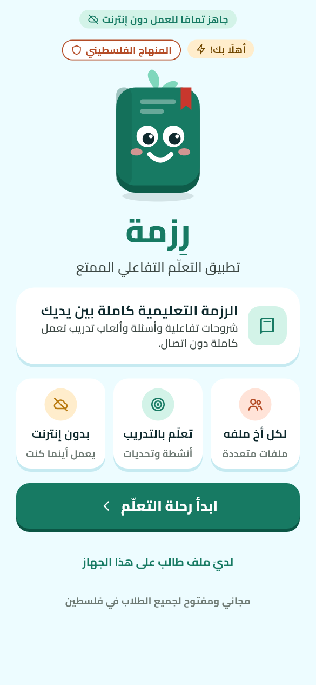<br><sub>الترحيب</sub></td>
    <td align="center">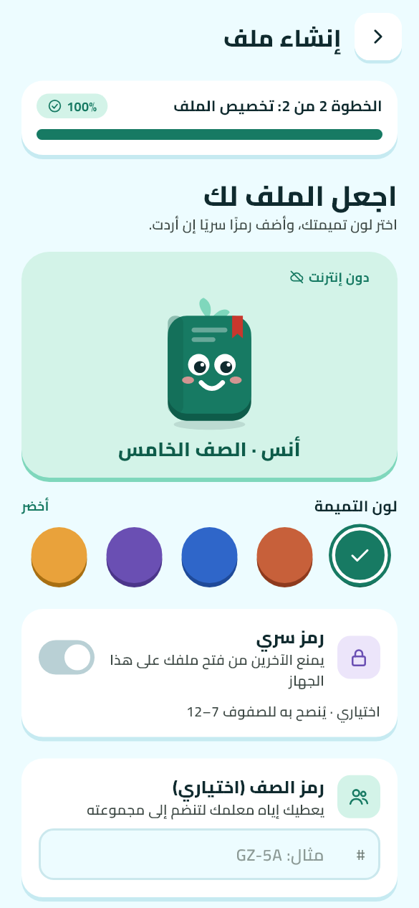<br><sub>إنشاء الملف</sub></td>
    <td align="center">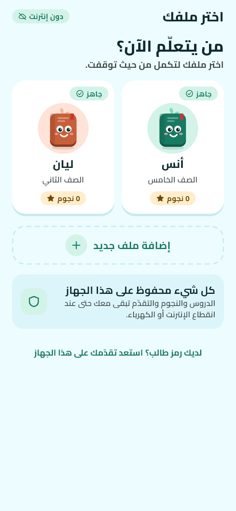<br><sub>من يتعلّم الآن؟</sub></td>
    <td align="center">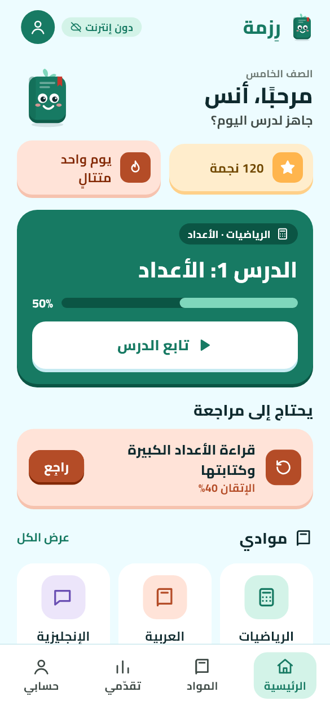<br><sub>الرئيسية</sub></td>
  </tr>
  <tr>
    <td align="center">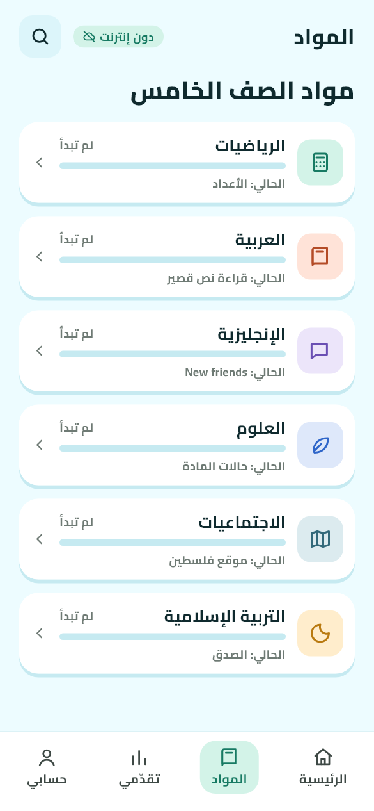<br><sub>المواد</sub></td>
    <td align="center">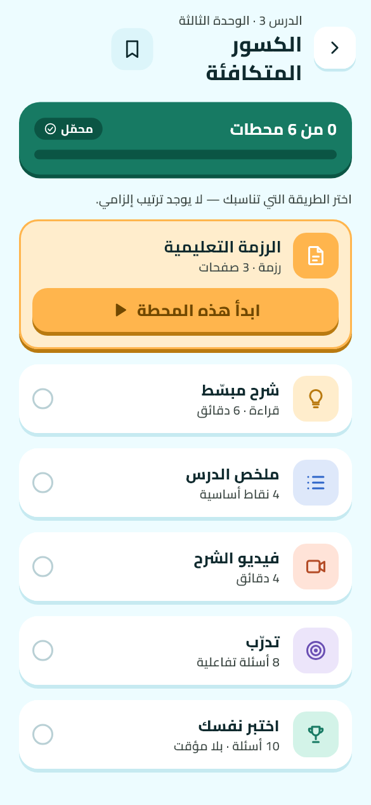<br><sub>مركز الدرس</sub></td>
    <td align="center">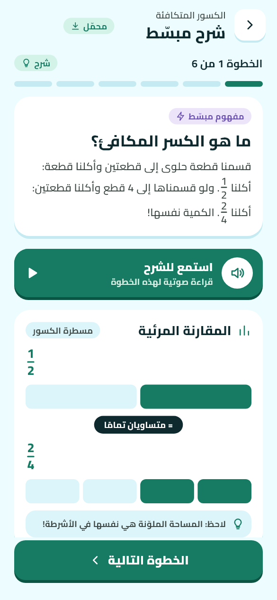<br><sub>الشرح المبسّط</sub></td>
    <td align="center">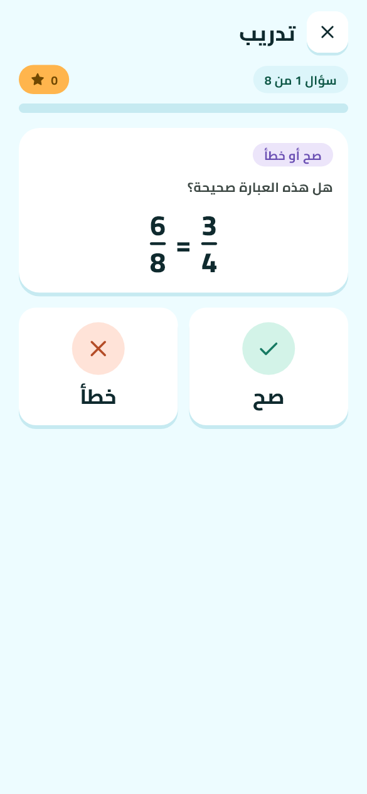<br><sub>التدريب</sub></td>
  </tr>
  <tr>
    <td align="center">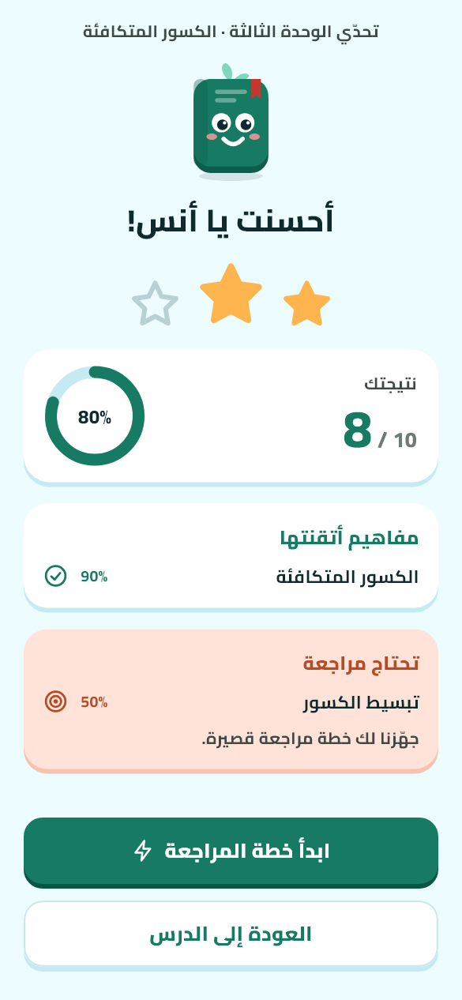<br><sub>نتيجة الاختبار</sub></td>
    <td align="center">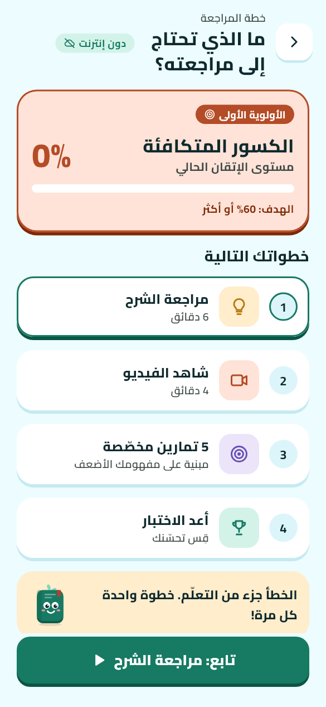<br><sub>خطة المراجعة</sub></td>
    <td align="center">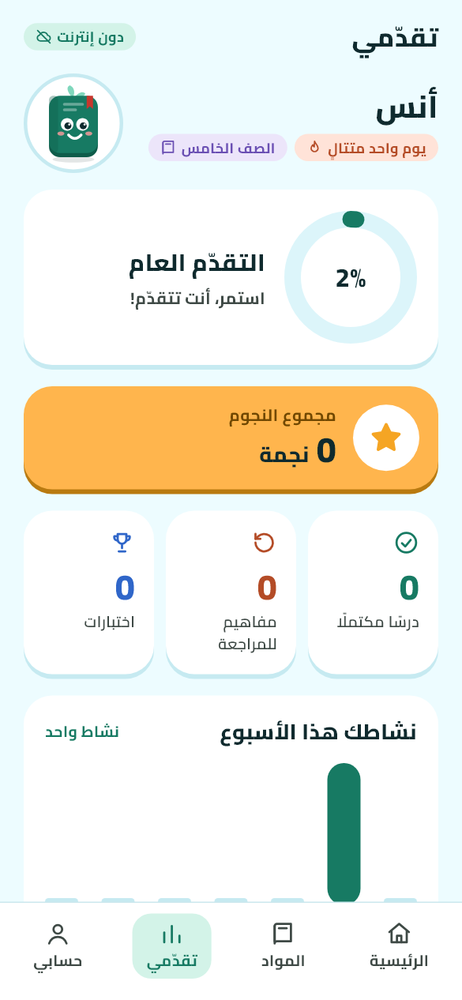<br><sub>تقدّمي</sub></td>
    <td align="center">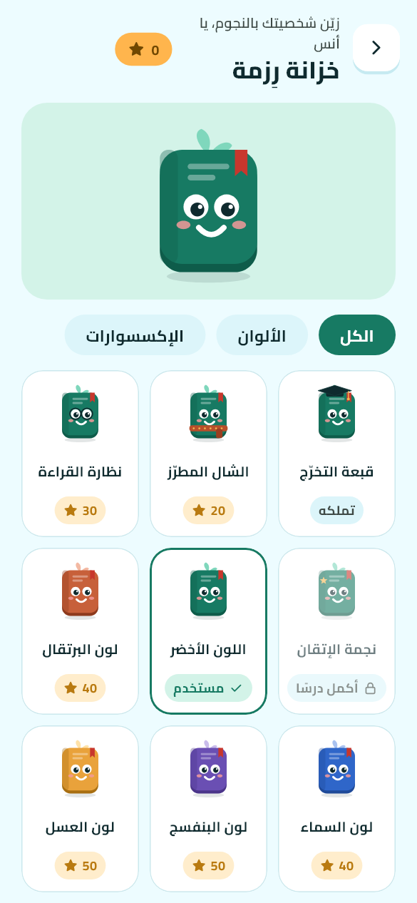<br><sub>الخزانة</sub></td>
  </tr>
  <tr>
    <td align="center">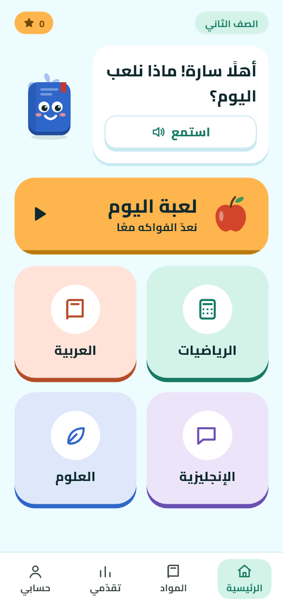<br><sub>رئيسية الصغار</sub></td>
    <td align="center">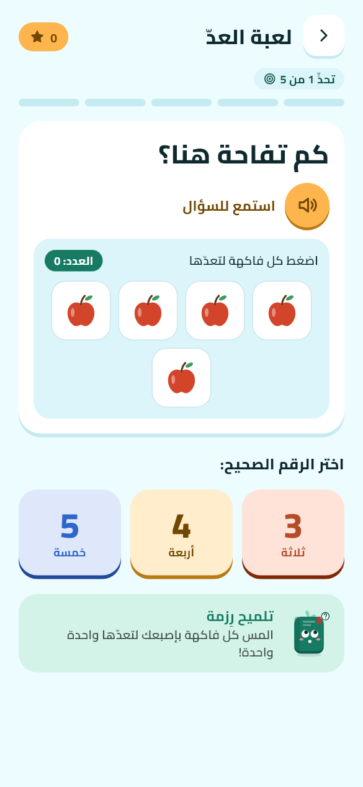<br><sub>لعبة العدّ</sub></td>
    <td align="center">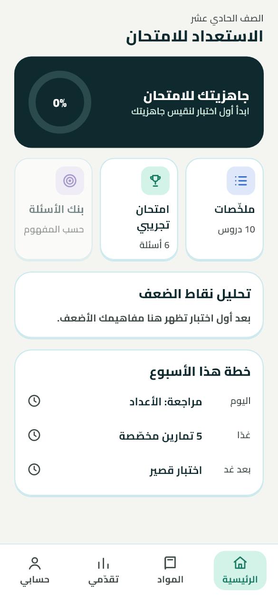<br><sub>الاستعداد للامتحان</sub></td>
    <td align="center">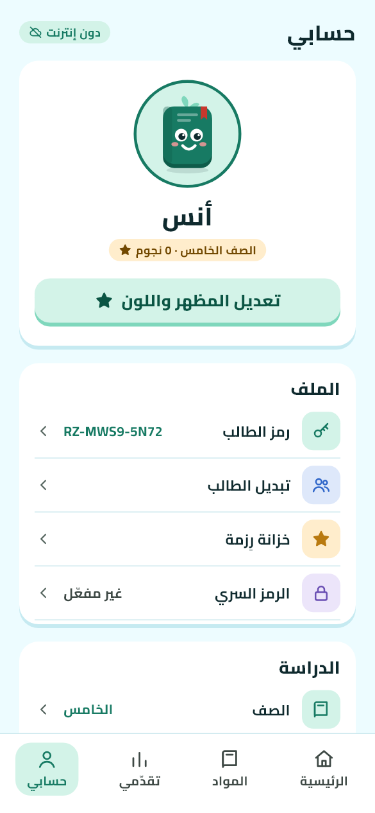<br><sub>حسابي</sub></td>
  </tr>
</table>

## الميزات

**الملفات الشخصية**
- عدة طلاب على هاتف واحد، بيانات كل طالب منفصلة تمامًا.
- رمز سري من 4 أرقام (يُخزَّن مجزّأً) مع قفل 30 ثانية بعد 5 محاولات خاطئة.
- رمز طالب فريد `RZ-XXXX-XXXX` لاستعادة الملف والرمز السري.

**التعلّم**
- المواد ← الوحدات ← الدروس ← مركز الدرس (يختار الطالب ترتيب المحطات).
- أجزاء الدرس: الرزمة (صفحات الكتاب)، الشرح المبسّط بالصوت، الملخص، الفيديو، الكلمات والنطق.
- ستة أنواع أسئلة: اختيار، صح/خطأ، استمع واختر، سحب وإفلات، توصيل، ترتيب.
- تدريب بتلميحات متدرّجة (نجوم 3/2/1)، واختبار بلا مؤقّت أو تلميحات.
- خطة مراجعة للمفهوم الأضعف، وعتبة إتقان موحّدة 60%.

**التحفيز**
- نجوم تُصرف في «خزانة رِزمة» (إكسسوارات وألوان للتميمة)، وشارات، وسلسلة أيام.
- رئيسية خاصة للصغار مع لعبة عدّ، ولوحة «استعداد للامتحان» للصفوف 9–12.

**دون إنترنت وبالإنترنت**
- قاعدة بيانات محلية (Drift/SQLite)؛ التطبيق يعمل كاملًا بلا اتصال.
- **مزامنة** اختيارية مع Supabase واستعادة الملف على هاتف جديد.
- **تنزيل الدروس** من مخزن موقّع (Ed25519 + بصمات SHA-256) مع الاستئناف عند الانقطاع.
- **نقل الدروس بين الهواتف**: ملف `.rizma`، أو Wi-Fi مباشر، أو Nearby دون شبكة.

## البنية

```
الشاشة (Widget)  ←  المزوّد (Riverpod)  ←  المستودع (Repository)  ←  DAO (Drift)  ←  SQLite
                                                   │
                                                   └──  SyncService  ⇄  Supabase (نسخة احتياطية)
```

الاعتماد يسير من الأعلى إلى الأسفل فقط. **القواعد في المستودعات**، والقيم المشتقة (النجوم، النسب، الشارات) **تُحسب ولا تُخزَّن**.

```
lib/
  app/          التشغيل والمسارات (go_router) والانتقالات
  core/         db · theme · widgets · utils · strings · constants
  features/     account · catalog · content · downloads · home · kids · launch
                learning · onboarding · profiles · progress · sharing · sync · wardrobe
assets/         fonts (Cairo) · icons · images · content (دروس JSON)
test/           اختبارات الوحدة والواجهة والتدفقات
supabase/       الخادم: migrations (SQL) واختبارات pgTAP
tools/content/  أدوات فريق المحتوى (Node): بناء الدروس والنشر الموقّع
docs/           ADR · شرح بحسب الموضوع · أدلة الدراسة (PDF)
```

## التشغيل

**المتطلبات:** Flutter 3.38 (Dart ‎≥ 3.10) وأندرويد SDK (الحد الأدنى API 24).

```bash
flutter pub get
flutter analyze          # يجب أن يظهر: No issues found
flutter test             # كل الاختبارات
flutter run              # على جهاز أو محاكي
```

للتجربة على المتصفح (ثبّت المنفذ لأن البيانات تُحفظ لكل منفذ):

```bash
flutter run -d chrome --web-port=5000
```

بناء APK:

```bash
flutter build apk --release
```

> توقيع نسخة الإصدار حاليًا **debug**؛ لا يصلح للنشر على Google Play قبل إضافة مفتاح إصدار.

### إعدادات البناء الاختيارية

| الخيار | الأثر |
|---|---|
| `--dart-define=RIZMA_SYNC=off` | إيقاف المزامنة كلها |
| `--dart-define=RIZMA_SUPABASE_URL=… --dart-define=RIZMA_SUPABASE_KEY=…` | خادم مزامنة آخر |
| `--dart-define=RIZMA_CONTENT=off` | إيقاف تنزيل المحتوى |
| `--dart-define=RIZMA_CONTENT_URL=…` | مخزن محتوى آخر |

### قاعدة البيانات

Drift (SQLite) بإصدار مخطط **6** و12 جدولًا. بعد تعديل أي جدول:

```bash
dart run build_runner build
```

ثم ارفع `schemaVersion` وأضف خطوة في `onUpgrade` وصدّر لقطة المخطط إلى `drift_schemas/` وحدّث اختبار الترحيل.

### لقطات الشاشات

```bash
flutter test tool/shots/shots_test.dart --dart-define=SHOTS_DIR=build/shots
```

## الاختبارات

أكثر من **440 اختبارًا** تغطي المنطق الصرف (محرّك الأسئلة، الحالات المشتقة)، والمستودعات على قاعدة حقيقية في الذاكرة، والواجهة (تدفقات كاملة، وتخطيط الشاشات الضيقة 320×568 بخط مكبّر)، والمزامنة والتنزيل والنقل بين الهواتف بخوادم وهمية. واختبارات الخادم (`supabase/tests`) تعمل بـ pgTAP.

## التوثيق

| | |
|---|---|
| [`docs/study_guides/`](docs/study_guides) | **أدلة الدراسة (PDF)**: دليل لكل مرحلة وجزء، ابدأ بـ `00_فهرس_الأدلة.pdf` |
| [`docs/explanations/`](docs/explanations) | شرح بحسب الموضوع |
| [`docs/line_by_line/`](docs/line_by_line) | شرح الكود سطرًا بسطر |
| [`docs/adr/`](docs/adr) | قرارات التصميم: المزامنة، تنزيل الدروس، النقل بين الهواتف |
| [`supabase/README.md`](supabase/README.md) | العقد بين التطبيق والخادم |
| [`tools/content/README.md`](tools/content/README.md) | نشر المحتوى |

## قواعد العمل

- كل نص ظاهر للمستخدم في `lib/core/strings/ar*.dart`.
- الألوان والخطوط من `AppColors` و`AppTextStyles` فقط، والاتجاه بـ `EdgeInsetsDirectional`.
- كل استعلام يحمل `profileId` فلا يرى طالب بيانات أخيه.
- لا مفاتيح سرية في المستودع (مفتاح توقيع المحتوى ومفاتيح R2 خارجه).
- لا تعرض رقمًا أو زرًا لا يعمل فعلًا.

## قيد التطوير

الوضع الداكن · العدّ التنازلي للتوجيهي · المستويات والألقاب · منطقة الأهل والمعلم · محرّك الألعاب العشوائي · مفتاح توقيع Google Play.
